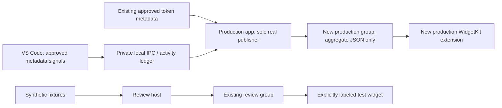

# Production widget connection: boundary and approval plan

Latest status: direct approval resolved the earlier execution-policy block. Production build 2106 is installed and writes real non-sample aggregates to the approved group. See [current verification and remaining locked-screen checks](PRODUCTION-WIDGET-VALIDATION-2106.md). Earlier blocked/proposal descriptions below are historical.

Status update: the user has since approved the production group and existing-certificate signing. Build 2105 is prepared and verified, but automatic approval review blocked replacing/registering/launching the operating app. The latest installed build remains 2104 and the production group has not been created. See [build 2105 deployment state](PRODUCTION-WIDGET-ROLLOUT-2105.md). The proposal and approval draft below record the earlier stage; they do not negate the later user approval.

## What is installed now

| Component | Identity / path | Data and rights |
|---|---|---|
| Production app | `com.contextos.app`, `~/Desktop/ContextOS.app` | Existing local token-metadata readers; private activity receiver remains off in this bundle's preferences. No group entitlement and no embedded widget extension. |
| Review host | `com.contextos.review`, `~/Applications/ContextOS Widget Review.app` | Existing approved `Y56BH9PULD.com.contextos.review.usage` entitlement. Its token publisher uses synthetic fixtures, not DashboardModel or the real token reader. Review can attach its local time panel snapshot; token and time provenance are separate flags. |
| Installed desktop widget | `com.contextos.review.widgets`, inside Review host | Sandboxed; same review group only. Reads `usage-v1.json`. Existing group JSON has `isSample: true`. Configured gallery title in the installed build is **“ContextOS 테스트 · 샘플”**. Headers say “테스트”; valid token footer says “샘플 · 실제값 아님”. |
| Time candidate | `com.contextos.timecandidate`, under isolated workspace artifacts | No group / extension. Prior receiver opt-in belongs to this bundle alone; it was not copied to production or Review. |
| VS Code bridge | installed `contextos.observation-bridge` 0.2.1 | Existing callback-count/focus/selection/scroll signals, local Unix IPC. Real-profile enabled setting was not rewritten. |

The existing private bridge endpoint and aggregate are `~/Library/Application Support/ContextOS Observation Candidate/observations.sock` and `activity-day-v1.json`. The former is a same-user private socket, not a shared widget container. The latter is a bounded aggregate of one day, not a history of events. Current candidate, Review and production builds use this legacy endpoint name if individually enabled. This must not be mistaken for three independent production stores.

The production app's actual window reports “공유 권한 설정 필요”. This is explained by the absent group configuration. The actual window also reports Claude partial collection; the exact parse/discovery reason has not been diagnosed, and it was not relabeled as a quota issue. The exact warning on the desktop widget itself has not been safely captured.

## Changes completed without new rights

`WidgetSnapshotStore` now defaults to the production channel. Production reads reject `isSample: true`; production writes reject it before touching the previous file. Only explicit Review calls permit samples. A regression test proves a rejected sample cannot replace the last real aggregate, and proves old review samples read as missing on the production path. This is a code-level accident guard, not an OS access-control boundary.

Review gallery and all three header sizes explicitly identify testing. Source, stale and missing warnings are retained. A missing activity estimate remains `—`, not zero. The shared file's sample flag and exact existing group identifier were checked after install. These changes do not connect real usage to the installed desktop widget.

## Recommended final separation — requires approval before applying

Use a **separate production group**, proposed `Y56BH9PULD.com.contextos.usage`. Do **not** reuse `Y56BH9PULD.com.contextos.review.usage`: reusing it would let Review's sample publisher and the real publisher overwrite one file, and give Review access to production aggregates. A sample-rejecting reader would then safely show missing data, but would not fix the competing publishers. Reusing the review group would still require approval to grant the production app new membership; it is not a way around the approval boundary.

| App / extension | Proposed access | Not granted |
|---|---|---|
| `com.contextos.app` | Existing readers remain the source; write aggregate-only `usage-v1.json` to the production group. | No broader home-directory collection, raw prompt/file content or credentials in the group. |
| New embedded `com.contextos.app.widgets` | Production group entitlement; code reads the aggregate and opens `contextos://usage`. | No raw `.codex` / `.claude` logs, private activity store/socket, network entitlement or API keys. |
| Review host + `com.contextos.review.widgets` | Existing review group unchanged. | No production group membership. |
| VS Code bridge | Existing private local IPC stays outside both widget groups. | No App Group entitlement or direct widget-store access. |

The shared aggregate contract currently contains seven daily token counts, top tool/model/project display labels and counts, provider source states/event times, aggregation time/time zone, aggregate manual/foreground/estimated activity values and phase, small-widget selection and mascot preference. Project labels are basename plus a disambiguator, not full paths. Raw prompts, file content, token-account credentials, editor documents, session IDs and raw editor-event logs are excluded. Unsupported rank fields should be omitted from the final production projection if the shipped widget does not display them; that minimization should be tested before the first real group write.

The OS group entitlement permits member processes to access the shared container; it is **not** an enforced read-only entitlement for the widget. Host-writes/widget-reads is our implementation rule, so the group must contain only the intended aggregates. Runtime obtains its container using `FileManager.containerURL`, with no guessed fallback to another app's path.

## Signing and provisioning — exact proposed change

1. Embed the real extension under the existing production bundle ID, using extension ID `com.contextos.app.widgets` and production deep link `contextos://usage`. Keep production application ID and existing user preferences.
2. Add exactly the proposed production group entitlement to that host and extension, and the matching `ContextOSAppGroup` metadata. The extension remains sandboxed. Do not turn the host into a newly sandboxed application, which could disrupt its existing approved local readers.
3. Production is currently ad-hoc signed. Re-sign host and nested extension using the **already available Apple Development identity**, whose existing Review signature has observed team `Y56BH9PULD`. No certificate creation, account login, keychain sharing entitlement, notarization, App Store upload or public release is needed for the proposed local test.
4. Apple's macOS Team-ID group format does not require website registration. Current working Review bundles have no `embedded.provisionprofile`. Do not claim a new provisioning profile is necessarily required. Try the existing local signing setup only after approval; if Xcode or the OS requires a profile/account change or new consent, stop and report that exact requirement instead of creating it automatically.
5. The first real runtime check must confirm actual host and extension team/group signatures, successful container resolution and shared aggregate values, then desktop rendering. `codesign --verify` and extension registration alone do not prove a real widget rendered or read the group.

Primary source: [Apple App Groups Entitlement](https://developer.apple.com/documentation/bundleresources/entitlements/com.apple.security.application-groups). The official Markdown was fetched to `artifacts/apple-app-group-entitlement.md`. Apple confirms `<team identifier>.<group name>` on macOS does not require registration, and that groups enable shared-container access between sandboxed and nonsandboxed applications. [Widget refresh guidance](https://developer.apple.com/documentation/widgetkit/keeping-a-widget-up-to-date) remains applicable; do not promise real-time refresh.

## Activity ownership and preservation

Before enabling real production activity, make production the single persistent activity owner. A development/test process must not write the production activity file. Keep the existing endpoint compatible initially so saved connection information is not rewritten. Give production its own private aggregate location; if importing the old candidate's one-day aggregate is approved, copy a validated value only when the destination is absent, restore paused/partial, and retain the original file. Never add two cumulative counters together or invent a missing interval.

A follow-up implementation must gate persistence on successful receiver ownership, ignore callbacks from older receiver generations, and test an occupied socket, rapid disable/re-enable and restart before allowing a second build to become an owner. The current server refuses to replace an existing socket and only removes its own inode; that protects the endpoint, but by itself does not establish the complete host/storage lifecycle. This is a reviewed design boundary, not a claim that a current user's data was overwritten.

Private unit/integration tests continue to use `/tmp/cxi-*` and mocked clocks. No test should instantiate a production DashboardModel or resolve either real group. Keep real-profile opt-in distinct from “VSIX installed”: existing consent/settings must not be silently inferred from test results.

## Rollout and rollback after approval

- Preserve original and current app bundles, exact signatures and private data; record hashes. No historical data or preferences are deleted.
- Install the production host + extension atomically. Leave Review separately named and clearly labeled; never repoint its group to production.
- User adds the **production** widget once in macOS's widget picker; existing Review widgets remain explicitly test widgets and are not silently converted or deleted.
- Verify one aggregate across host, status bar and all widget sizes, missing/zero/source-state semantics, an idle/resume and disconnect/reconnect sequence, and an app restart. Distinguish synthetic clock tests, actual observed runtime, actual widget screenshots and long-duration performance.
- Roll back by normally quitting the exact new app, retaining it as another backup, restoring the recorded previous bundle and verifying the original hash/signature. Leave new aggregates preserved for inspection; do not delete the group or old private store. Remove/re-add the production widget only if the OS requires it; do not reset all widgets or Notification Center.

## Suggested single approval request for the parent

> 실제 사용량을 위젯에 연결하려면 ContextOS 운영 앱과 전용 위젯에 로컬 공유 권한 하나를 추가해야 합니다. 테스트용 공간과 분리된 공간으로 토큰 합계·사용 순위·추정 활동 시간 같은 집계만 공유하고, 프롬프트·파일 내용·API 키는 공유하지 않습니다. 기존 개발 인증서로 서명하고 현재 앱과 기록은 백업·보존합니다. 이 범위의 권한 추가와 로컬 설치를 진행해도 될까요?

This is a prepared request, **not recorded approval**. If production ownership/import or a real-profile connection setting change is also needed, name that concrete migration before applying it; the group approval does not authorize unrelated new collection.

## Follow-up verification evidence (build 2104)

- Full local macOS regression: **93 XCTest + 254 Swift Testing = 347 pass** (`artifacts/widget-boundary-full-tests.log`). Targeted boundary/activity/socket suites: 39 pass (`widget-boundary-tests.log`).
- Actual Unix IPC against the latest Release test host: 1 integration pass (`widget-boundary-final-ipc-tests.log`). Two simulated editor windows share the central value; idle/resume, disconnect/reconnect, save/restore and multi-frame delivery are checked. VS Code API events and clocks remain synthetic; production settings/socket/aggregate were not used.
- Official installed VS Code 1.140.0 Extension Host: 0.2.1 activated with a real synthetic-document edit callback; pass (`widget-boundary-vscode-host.log`, `vscode-extension-host-smoke.json`). Bridge disabled by design; no real-user-activity or screen/status-bar equality claim. Isolated profile removed, own sleep prevention released.
- Release host and WidgetKit arm64/x86_64 build passed (`widget-boundary-release-build.log`, `channel-boundary-widget-build.log`). 84 synthetic layout PNGs regenerated under `artifacts/channel-boundary-renders`; small/medium sample headers and missing-activity warning visually inspected.
- Both installed host paths are running build 2104; installed and previous-backup executable hashes match deployment records (`channel-boundary-postinstall.json`, `budget-install-result.json`). Production group is still absent, Review group unchanged. Original and intermediate bundles remain retained; no setting or data migration was performed.
- Tool inventory contains no general native CUA tool. The only screen-context tool is voice-only and was not invoked in this text task. Existing screen capture and Accessibility grants returned true, so only ContextOS-owned window inspection was attempted. The desktop extension exposed no own CG window or accessible window (`OwnAXWindowsResult -25204`). Later targeted host-window screenshots returned `could not create image from window`. No desktop-wide capture, unlock, permission prompt, Dock reset or other-app interaction was attempted. Therefore actual desktop-widget warning text and post-2104 native widget pixels remain **unverified**. Previous 2103 host-window screenshots are historical evidence, not substituted as new widget screenshots.
